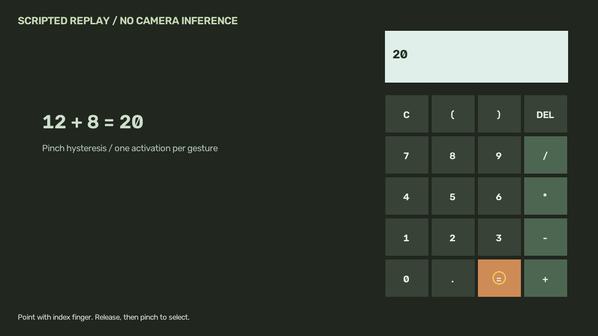

# Gesture Controlled Virtual Calculator Project Report

## Engineering approach

OpenCV captures and mirrors webcam frames. A pretrained MediaPipe Hand Landmarker supplies fingertip and palm coordinates. The index fingertip selects a screen key. Thumb-index distance, divided by palm width, controls a pinch gate with separate close/release thresholds. A stable hover is required, a held pinch produces at most one event, and loss of tracking disarms the gate. Arithmetic is parsed through a small allowlisted AST evaluator; Python eval is never used.

## Reproduction

Install the pinned development requirements in a clean Python 3.12 environment. Run `python -m pytest -q`, then `python app.py --demo`. Configuration, fixed seeds and ground-truth generation are visible in `app.py`. Actual outputs are recorded in `outputs/results.json`.

## Evaluation

16 unit tests passed. A scripted sequence produced exactly five key activations and calculated 12 + 8 = 20. The replay validates input gating and arithmetic, not camera hand-detection accuracy. Live webcam use needs validation on the user's machine.

## Interpretation and limitations

Lighting, hand occlusion, camera placement and the palm-normalised pinch threshold affect usability. The UI currently supports one hand and a fixed 1280 x 720 display. No hand-recognition accuracy or real-user latency benchmark has been measured. The pretrained model is provided by Google and is not trained by this project. The current evidence supports this limited demonstration. Independent tests on new real inputs are needed before presenting broader performance claims.

## Next experiment

Run the live camera app, record a short demonstration, and test at least 20 expressions under multiple lighting conditions. Log false presses, missed presses and completion time before claiming camera performance.

## How to explain this in an interview

Explain the input assumptions first, then walk through the pipeline and a failure case. Show the test and generated result that supports each numerical claim. Be able to change one threshold, rerun the experiment and explain how it affects the result.

## References

- https://developers.google.com/edge/mediapipe/solutions/vision/hand_landmarker/python
- https://developers.google.com/edge/mediapipe/solutions/vision/hand_landmarker/index
- https://docs.opencv.org/4.13.0/d8/dfe/classcv_1_1VideoCapture.html
